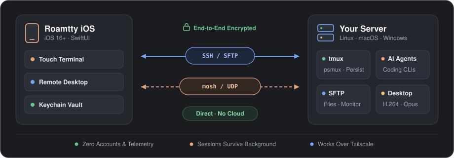

# Roamtty iOS

**English** | [简体中文](README.zh-CN.md)

Native Swift SSH, terminal, and remote desktop client for iPhone — built for remote AI coding (`Claude Code`, `Codex`, `Grok`, `Antigravity`).

`iOS 16+` · `SwiftUI + UIKit` · `com.roamtty.app.ios` · [App Store](https://apps.apple.com/app/id6826986771) · [Website](https://roamtty.com/en/) · [Android Client](https://github.com/yahaa/roamtty) · [Desktop Plugin](https://github.com/yahaa/roamtty-desktop)



## Highlights

- **Hosts & Trust** — Password, interactive auth, or OpenSSH/PEM private keys (Ed25519, RSA, encrypted keys) via `libssh2` + OpenSSL. Auto-detects OS, online state, and latency. Strict TOFU SHA-256 fingerprint pinning blocks changed host keys until explicitly cleared.
- **Persistent Sessions** — Independent `tmux` (POSIX) or `psmux` (Windows) sessions (up to 8 per host) survive iOS background suspension. Prefers `mosh` over UDP (60000–61000) with 8 s fallback to SSH. One-tap plugin installer included.
- **AI Coding Agents** — Launch `Claude Code`, `Codex`, `Grok`, or `Antigravity CLI` in any remote folder with Plan/Read-only, Standard, or YOLO permissions. Session cards group into `Needs you`, `Running`, and `Done` with quick Approve / Reply actions.
- **Touch-First Terminal** — Powered by a pinned [`SwiftTerm`](docs/dependencies/swiftterm.md) fork with gestures for Tab, paste, history scroll, cursor drag, arrow keys, and pinch zoom. Floating Ghost button opens the action bar on tap and a context-aware shortcut ring on hold.
- **Remote Desktop** — One-tap [`roamtty-desktop`](https://github.com/yahaa/roamtty-desktop) setup with `VideoToolbox` H.264 decoding, Opus audio, UDP + Reed-Solomon FEC (auto-fallback to SSH), and Mac-style multi-touch gestures (Linux X11 / wlroots Wayland, macOS 13+, Windows 10/11).
- **Files, Share Extension & Port Preview** — SFTP browser with syntax-highlighted code, Markdown, and image previews; Files app integration (`On My iPhone › Roamtty`); iOS Share Extension (`RoamttyShare`); live host monitor; SSH loopback preview for remote `localhost` web servers.

> Roamtty runs no models and no local Linux shell — everything runs on your own servers. iOS pauses background networking; `tmux` keeps remote tasks alive and Roamtty reattaches on return.

## Privacy & Security

- **Local-only**: no accounts, no ads, no analytics, no telemetry, no backend server.
- **Device-only Keychain**: saved passwords and keys stay in non-synchronizing Keychain storage bound to this device. Key passphrases and terminal buffers stay in memory only.
- **Backup-excluded store**: host metadata, pins, and session records live in SQLite excluded from iCloud and computer backups.
- Full policy: [roamtty.com/privacy](https://roamtty.com/privacy/).

## Build & Test

Requires **macOS** with **Xcode** and **Swift 6** (native deps are version-pinned and SHA-256 verified).

```sh
# Fetch pinned native libs and generate Xcode project
./scripts/bootstrap-native.sh
DEVELOPMENT_TEAM=YOUR_TEAM_ID python3 scripts/generate-project.py
open Roamtty.xcodeproj

# Lint and run Swift package tests
./scripts/lint.sh
swift test
```

See [Development & Testing](docs/DEVELOPMENT.md) for signing profiles, App Group builds, Docker/simulator UI suites, desktop gesture live tests, and Linux test setup.

## Documentation

| Document | Description |
| --- | --- |
| [User Guide](docs/USER_GUIDE.md) ([中文](docs/USER_GUIDE.zh-CN.md)) | Setup, AI agents, terminal gestures, remote desktop, Files & Share, FAQ |
| [Desktop Gestures](docs/DESKTOP-GESTURES.md) | Touch/trackpad gesture spec, parameters, and live test runner |
| [Architecture](docs/ARCHITECTURE.md) | App targets, Swift packages, Keychain/Share pipeline, VideoToolbox, SwiftTerm/libssh2 pins |
| [Development & Testing](docs/DEVELOPMENT.md) | Native bootstrap, signing, lint, SwiftPM, simulator, and live fixture suites |
| [App Store Release](docs/APP_STORE_RELEASE.md) | Export compliance (`ITSAppUsesNonExemptEncryption`) and territory configuration |
| [Dependencies](docs/dependencies/swiftterm.md) | Pinned forks & fixes: [`swiftterm.md`](docs/dependencies/swiftterm.md), [`libssh2.md`](docs/dependencies/libssh2.md) |
| [Third-Party Notices](THIRD_PARTY_NOTICES.md) | Open-source licenses for SwiftTerm, libssh2, OpenSSL, and bundled fonts |

## License

The original code in this version is source-available under the [PolyForm Shield License 1.0.0](LICENSE). You may view, use, and modify the code within permitted terms, but you may not use it to provide competing products or services (including free competitors). It is not an OSI open-source license.

Third-party components retain their own licenses ([THIRD_PARTY_NOTICES.md](THIRD_PARTY_NOTICES.md)). Existing Apache-2.0 grants for earlier versions in Git history remain unchanged. See [NOTICE](NOTICE) for full notices.
