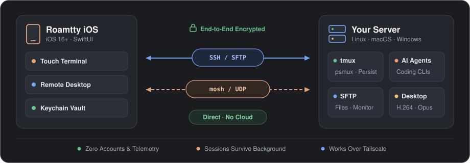

# Roamtty iOS

[English](README.md) | **简体中文**

面向远程 AI 编程的原生 Swift iOS SSH、终端与远程桌面客户端，支持 `Claude Code`、`Codex`、`Grok`、`Antigravity`。

`iOS 16+` · `SwiftUI + UIKit` · `com.roamtty.app.ios` · [App Store](https://apps.apple.com/app/id6826986771) · [官网](https://roamtty.com/) · [Android 版](https://github.com/yahaa/roamtty) · [桌面插件](https://github.com/yahaa/roamtty-desktop)



## 核心特性

- **主机与信任** — 基于 `libssh2` + OpenSSL，支持密码、交互式认证及 OpenSSH/PEM 私钥（Ed25519、RSA，含加密私钥）。自动检测远端系统与延时；首次连接核对 SHA-256 指纹，指纹变化时强制拦截。
- **持久化会话** — 每台主机最多 8 个独立 `tmux`（POSIX）或 `psmux`（Windows）会话，切后台断网后回来无缝重附着；装有 `mosh` 时优先走 UDP（60000–61000），8 秒无回应自动回退 SSH，支持一键安装插件。
- **AI 编程 Agent** — 一键在指定目录启动 `Claude Code`、`Codex`、`Grok` 或 `Antigravity CLI`，支持计划 / 只读、普通与 YOLO 权限。会话卡片按「待确认 / 运行中 / 已完成」分组，支持快速批准与追问。
- **触控终端** — 基于固定版本的 [`SwiftTerm`](docs/dependencies/swiftterm.md) 分支，手势完成 Tab 补全、粘贴、历史回滚、光标拖动与双指缩放。侧边小幽灵点按展开操作栏，长按弹出随前台程序变化的快捷键环。
- **远程桌面** — 首次点按自动安装 [`roamtty-desktop`](https://github.com/yahaa/roamtty-desktop)，使用 `VideoToolbox` 硬解 H.264、Opus 音频、UDP + Reed-Solomon 纠错（3 秒自动回退 SSH）与仿 Mac 触控板手势（Linux X11 / wlroots Wayland、macOS 13+、Windows 10/11）。
- **文件、系统分享与端口预览** — SFTP 浏览与代码高亮 / Markdown / 图片预览、集成「文件」App（`我的 iPhone › Roamtty`）与分享扩展（`RoamttyShare`）、实时主机监控，以及通过 SSH 隧道直接预览远端 `localhost` Web 服务。

> 本应用不自带模型，也不在手机上运行本地 Linux。iOS 切后台后会暂停网络连接；远端任务由 `tmux` 保持，回到应用时自动重附着。

## 隐私与安全

- **纯本地运行**：无账号、无广告、无统计分析、无遥测，不运营应用后端。
- **仅限本机钥匙串**：保存的密码和私钥存储在不跨设备同步的 iOS Keychain 中；私钥口令与终端输出仅存于内存。
- **排除系统备份**：主机配置、指纹与会话记录存储在 SQLite 中，并排除在 iCloud 与电脑备份之外。
- 完整说明见 [隐私政策](https://roamtty.com/privacy/)。

## 构建与测试

环境要求：**macOS**、**Xcode** 与 **Swift 6**（原生依赖已固定版本并做 SHA-256 校验）。

```sh
# 拉取原生依赖并生成 Xcode 工程
./scripts/bootstrap-native.sh
DEVELOPMENT_TEAM=YOUR_TEAM_ID python3 scripts/generate-project.py
open Roamtty.xcodeproj

# 运行严格 Lint 与 SwiftPM 单元测试
./scripts/lint.sh
swift test
```

签名配置、App Group 构建、Docker / 模拟器 UI 测试套件、桌面手势真机测试及 Linux 测试环境见 [开发与测试指南](docs/DEVELOPMENT.md)。

## 文档导航

| 文档 | 说明 |
| --- | --- |
| [使用指南](docs/USER_GUIDE.zh-CN.md)（[English](docs/USER_GUIDE.md)） | 快速上手、AI Agent、终端手势、远程桌面、文件与分享、常见问题 |
| [远程桌面手势规范](docs/DESKTOP-GESTURES.md) | 触控 / 触控板手势表、阈值参数与真机验收脚本 |
| [架构与设计说明](docs/ARCHITECTURE.md) | App 目标、Swift 包分层、Keychain / 分享扩展、VideoToolbox 与依赖固定 |
| [开发与测试指南](docs/DEVELOPMENT.md) | 依赖初始化、签名与 App Group、Lint、单元测试与模拟器套件 |
| [App Store 发布配置](docs/APP_STORE_RELEASE.md) | 出口加密合规（`ITSAppUsesNonExemptEncryption`）与发行地区说明 |
| [核心依赖说明](docs/dependencies/swiftterm.md) | 上游固定与补丁：[`swiftterm.md`](docs/dependencies/swiftterm.md)、[`libssh2.md`](docs/dependencies/libssh2.md) |
| [第三方许可](THIRD_PARTY_NOTICES.md) | SwiftTerm、libssh2、OpenSSL 与内置字体许可声明 |

## 许可证

本版本自有代码采用 [PolyForm Shield License 1.0.0](LICENSE)。代码可查看并在许可范围内使用和修改，但不得用于提供与 Roamtty 竞争的产品或服务（免费竞品同样受限制）。这是源码可见许可，不属于 OSI 定义的开源许可。

第三方组件保留各自许可（见 [THIRD_PARTY_NOTICES.md](THIRD_PARTY_NOTICES.md)）。历史版本已授予的 Apache-2.0 权利不受影响。详见 [NOTICE](NOTICE)。
