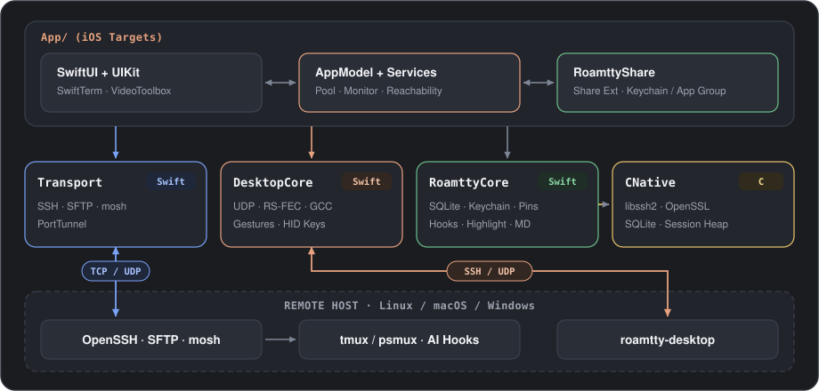

# Architecture & Design Constraints



## Targets & Package Layering

| Module / Target | Platform | Responsibility |
| --- | --- | --- |
| `CNative` | C (iOS / macOS / Linux) | C shims for `libssh2`, OpenSSL, SQLite, sockets, and per-session `ssh_heap` |
| `RoamttyCore` | SwiftPM (iOS / macOS / Linux) | Models, SQLite store, Keychain vault, host pins, reconnect rules, remote commands/hooks, syntax highlight & Markdown |
| `RoamttyTransport` | SwiftPM (iOS / macOS / Linux) | SSH/SFTP (`libssh2`), `mosh` UDP client, loopback `PortTunnel` |
| `RoamttyDesktopCore` | SwiftPM (iOS / macOS / Linux) | Desktop protocol, UDP + AES-128-GCM + RS-FEC/GCC link, `DesktopGestures`, HID keymaps, plugin manifest |
| `App/Roamtty` | iOS (SwiftUI + UIKit) | `AppModel`, services, `SwiftTerm` view, `VideoToolbox` display, feature screens |
| `App/ShareExtension` | iOS App Extension | `RoamttyShare` inbox producer (shares `App/Shared/` with main app) |

Pure Swift packages (`RoamttyCore`, `RoamttyTransport`, `RoamttyDesktopCore`) have zero UIKit dependencies and run under `swift test` on macOS and Linux.

### App Layer Structure (`App/Roamtty/`)

```text
Application/    Entry point & splash
Navigation/     Routes, sheets, root stack & drawer
Model/          AppModel (hosts, sessions, routes) + Connections/ & Hosts/ services
Services/       Diagnostics, reachability probe, SharedInbox, per-session preferences
DesignSystem/   Warm charcoal/peach tokens, shared components & formatters
Features/       Home, Hosts, Sessions, Terminal, Files, Desktop, Settings, Authentication
```

- Views observe `AppModel` and invoke actions. Connection/monitoring services (`HostLogins`, `HostConnectionPool`, `HostMonitor`, `HostReachabilityTracker`) depend only on the narrow `ConnectionEnvironment` protocol.
- Feature helpers take `ConnectionResolver` or `AppLanguage`, never the full `AppModel`.
- `scripts/generate-project.py` picks up all Swift sources automatically; re-run it after adding/moving files.

## Security, Storage & Share Extension

- **Host Store**: SQLite (`RoamttyCore/Persistence/`) stores host metadata, settings, host-key pins, and up to 8 `tmux` session records per host; excluded from iCloud and computer backups.
- **Credentials**: Passwords and imported private keys use device-only, non-synchronizing Keychain entries (`afterFirstUnlockThisDeviceOnly`). Key passphrases and terminal buffers stay in memory only.
- **Host Key Pinning (TOFU)**: Unknown server fingerprints require explicit approval; a changed key blocks authentication until the user explicitly clears the old pin (**Verify again**).
- **Share Extension (`RoamttyShare`)**: Queues up to **20 files** (total **64 MiB**) per share transaction across app restarts until uploaded or deleted. Uses App Group (`group.com.roamtty.shared`) when enabled, or a separate device-only shared Keychain access group (strictly isolated from the app's private host-credential Keychain group).
- **Local Previews & Diagnostics**: Latest agent status summaries (prompt ≤ 200 chars, reply ≤ 400 chars), desktop host JPEG thumbnails, and local diagnostics (≤ 400 event logs + 20 MetricKit reports) stay strictly on-device and never upload automatically.

## Remote Desktop & Media Pipeline

- **Host Plugin**: Uses [`yahaa/roamtty-desktop`](https://github.com/yahaa/roamtty-desktop), version & per-target SHA-256 pinned in `Sources/RoamttyDesktopCore/Resources/desktop-plugin.json` (byte-identical to Android). Protocol goldens live in `Tests/RoamttyDesktopCoreTests/Resources/desktop-proto/`.
- **Install**: Host downloads directly; on failure, iPhone downloads and uploads over SFTP → SHA-256 verify → atomic rename.
- **Video & Audio**: `H264` (Annex-B → AVCC) + `DesktopVideoDecoder` feed `VideoToolbox` (`AVSampleBufferDisplayLayer`) for hardware H.264 decoding; 48 kHz stereo Opus audio plays via `AudioJitter` buffer (playback only, no microphone capture).
- **UDP Link**: Plaintext `dir | seq` + AES-128-GCM (`CryptoKit` on Apple, `swift-crypto` on Linux), GF(2⁸) Reed-Solomon FEC, NACK, simplified GCC, 3 s silence fallback to SSH, and `NWPathMonitor` roaming on network changes. Leaving the page sends `PAUSE` (configurable 5 / 10 / 30 min keep-alive); reconnects use `--resume` (30 s window).

## AI Agent Hooks & iOS Lifecycle

- **AI Hooks**: Launching Claude Code, Codex, Grok, or Antigravity (`agy`) on POSIX hosts installs `~/.roamtty/agent-hook.sh` plus `--settings` (Claude) or launchers (`codex`, `grok`, `agy`). Hooks write live status into tmux session options (`@roamtty_agent`, `@roamtty_task`), polled over SSH.
- **Background Suspension**: iOS suspends background networking. `tmux` / `psmux` preserves remote processes on the server; returning to the foreground automatically reattaches sessions and resumes `mosh` probing.

## Pinned Native & Upstream Dependencies

- **SwiftTerm fork**: v1.13.0 base + 2 downstream memory/tail patches (`0a311223749cf1b96294772a2c5478be67915572`). Details: [docs/dependencies/swiftterm.md](dependencies/swiftterm.md).
- **libssh2 + per-session heap**: `apotocki/libssh2-iosx` 1.11.1.0 with `Sources/CNative/ssh_heap.c` reclaiming leaked AES-GCM KEX buffers (`libssh2#1951`). Details: [docs/dependencies/libssh2.md](dependencies/libssh2.md).
