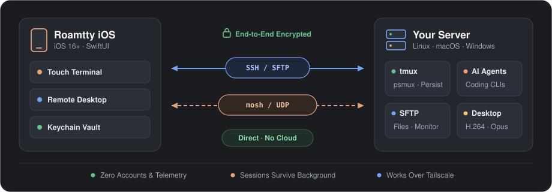
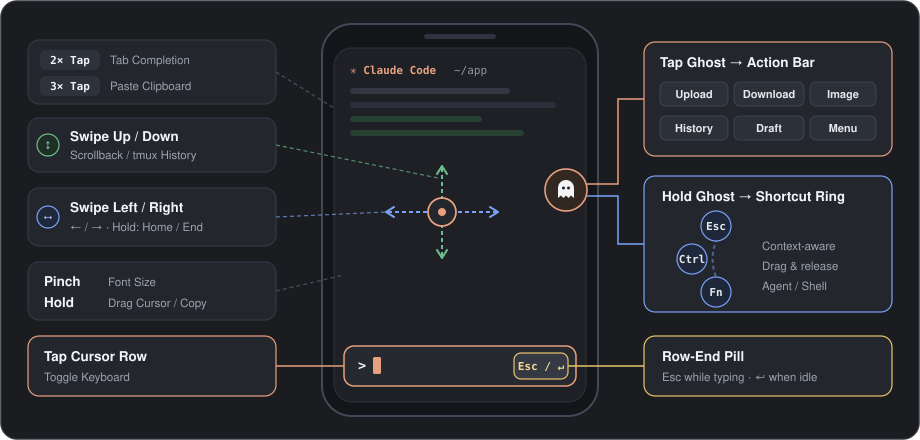
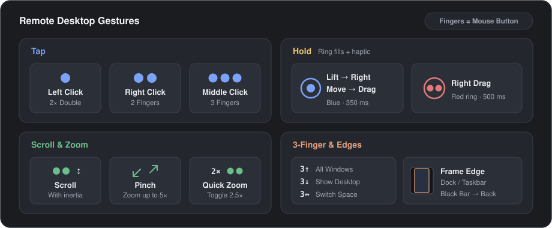

# Roamtty iOS User Guide

**English** | [简体中文](USER_GUIDE.zh-CN.md)

Get started in 3 steps: **Add Host → Start Agent or Shell → Work from Anywhere**.

> Roamtty is a client only — AI tools run on your own server. For remote access without exposing SSH publicly, connect over [Tailscale](https://tailscale.com/).

## 1. Add a Host

1. Open **Hosts** and tap **+**.
2. Enter a name, address (hostname, LAN IP, or Tailscale `100.x.y.z`), port, and username.
3. Choose **Password**, **Private key** (Ed25519 / RSA, encrypted keys supported), or **Interactive auth**. Saved credentials stay in device-only Keychain; key passphrases are never stored.
4. Keep session mode on **tmux** (recommended), then tap **Save**.
5. On first connect, verify the server's **SHA-256 fingerprint** and tap **Trust and connect**. (For LAN hosts, allow iOS **Local Network** access when prompted.)

> If a host's fingerprint changes later, Roamtty blocks the connection. Only use **Verify again** after confirming the server was reinstalled or rekeyed.

Tap a host's **⋮** menu to open a terminal, browse files, start an AI agent, install plugins (`tmux` / `psmux` and `mosh`), edit, or delete the host.

## 2. Start an AI Agent or Session

Open **Sessions** → tap **+** (or use the host card menu):

1. Pick an agent (**Claude Code**, **Codex**, **Grok**, **Antigravity CLI**) or **Terminal**.
2. Pick the host and starting folder.
3. Pick permissions:
   - **Plan / Read-only**: Claude Code & Antigravity plan first; Codex & Grok run in a read-only sandbox.
   - **Standard**: asks before editing files or running commands.
   - **YOLO**: skips approval prompts (use only for trusted environments).

Session cards group into **Needs you**, **Running**, and **Done** with live status, **Allow**, and **Reply** actions. Long-press a card to **Rename** or **Close** (up to 8 sessions per host).

## 3. Terminal Gestures & Ghost Toolbox

| Action | Result |
| --- | --- |
| Tap cursor row | Toggle keyboard (taps elsewhere don't) |
| Double tap | Send `Tab`; arrow keys appear beside the Ghost to pick completions |
| Triple tap | Paste clipboard |
| Swipe left / right | `←` / `→` (swipe and hold to jump to line start / end) |
| Swipe up / down | Scroll history (`tmux` sessions scroll tmux history) |
| Pinch | Adjust font size |
| Long-press | Drag cursor with magnifier on command line; select & copy on output |
| Tap URL | Open in browser or matching app (`localhost` URLs open in Port Preview) |
| **Tap Ghost** | Open Action Bar: session menu, upload, download, insert images (up to 9), shell history, draft editor, font size |
| **Hold Ghost** | Context-aware shortcut ring (`Esc`, `Ctrl`, `Shift`, `F1–F12`, agent shortcuts) |

The pill at the end of the cursor row shows **Esc** while typing and switches to **Enter** when idle.

## 4. Remote Desktop

Hosts with a graphical desktop show a **Desktop** button on the session card and host detail page. First tap installs `roamtty-desktop` automatically — no manual config needed.

- **Modes** (`Operations → Control mode`): **Touch** (direct tap & scroll, default) or **Trackpad** (relative cursor). Full gesture spec: [DESKTOP-GESTURES.md](DESKTOP-GESTURES.md).
- **Keyboard**: **IME** sends composed text (including CJK); **PC Keyboard** sends physical HID keys with modifier latch and combos. Hardware keyboards are supported.
- **Transport**: Uses encrypted UDP (60000–61000) with FEC and falls back to SSH within 3 s if blocked. Leaving the page keeps the session warm (default 10 min, configurable in Settings).
- **Exclusive control**: One phone controls a desktop at a time.

| Host OS | Requirement |
| --- | --- |
| Linux | X11, or wlroots Wayland (`sway`, `Hyprland`, `labwc`, `river`). GNOME/KDE Wayland not yet supported. |
| macOS 13+ | Grant **Screen & System Audio Recording** and **Accessibility** to *Roamtty Desktop* on first launch. |
| Windows 10 1903+ / 11 | Signed-in desktop session (or run `roamtty-desktop.exe install` as admin for lock-screen access). |

## 5. Files, Share Extension & Monitoring

- **Files (SFTP)**: Preview syntax-highlighted code, Markdown, and images; search inside files; rename, delete, upload, batch download, or start a terminal/agent in the current folder. Downloads save to the Files app under **On My iPhone › Roamtty**.
- **Share Extension**: Share photos, files, or text from Photos, Safari, or Files to **Roamtty** to queue uploads directly into a session (up to 20 files / 64 MiB per share).
- **Host Monitor**: Tap a host card for live CPU, memory, disk, network, GPU, and top processes.
- **Port Preview**: Tap a `localhost` URL in terminal output to preview the server's local web app over an on-demand SSH tunnel.

## 6. Background & FAQ

| Question | Answer |
| --- | --- |
| Why did the connection pause in the background? | iOS suspends background network connections. Remote tasks keep running in `tmux`, and Roamtty reattaches automatically when you return. |
| Can I share crash/hang logs? | Open Drawer → **About** to review and optionally share local diagnostics via the iOS share sheet. Logs never upload automatically. |
| Where is my data stored? | Locally on your iPhone only (Keychain + backup-excluded SQLite). See [Privacy Policy](https://roamtty.com/privacy/). |
